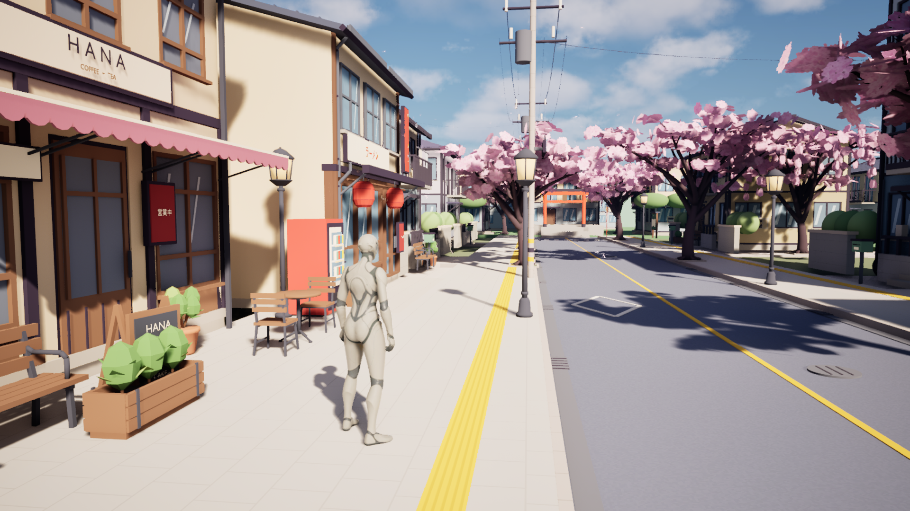
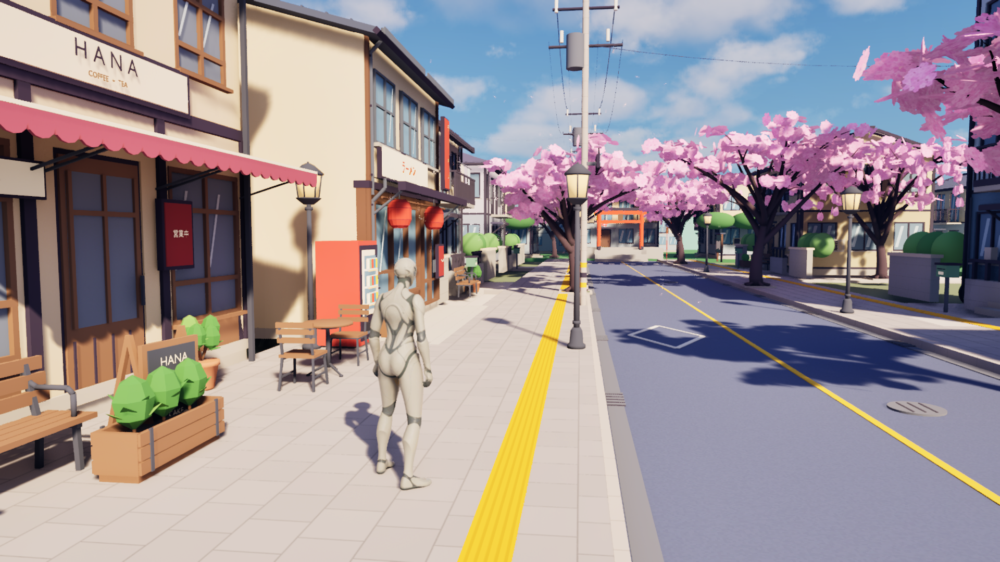

# Anime visual refinement — Prompt 13

Review date: 17 November 2026. This is a lighting and material refinement of the existing `/Game/SakuraDays/Maps/L_SakuraStreet`, building on [Prompt 12](TOWN_REFINEMENT.md). The town remains an early-development playable environment.

**Status:** three controlled Dream Loop passes completed. The baseline and each pass passed **32/32 PIE checks**. Final screenshots confirm the lighting/material changes in Unreal. Across all four runs, **739 geometry, collision, camera and spawn records remained unchanged**. The final saved-map hash matches its tested snapshot.

## Reference and Dream Loop method

The installed [Dream Loop skill](../.agents/skills/dream-loop/SKILL.md) selected its Plus workflow for this account: a fresh implementation worker proposes each visual pass, followed by independent Unreal execution, testing and screenshot review. Three visual iterations were used, within the requested limit. No new target was generated.

The locked target is [SakuraDays_First_Street_Target.png](../References/SakuraDays_First_Street_Target.png), identical to the local `.dream-loop/target.png`. The existing Style A and Style B images remain the primary style authorities described in [ART_DIRECTION.md](ART_DIRECTION.md). No new reference images accompanied Prompt 13, so those established references were used. Main Street informs composition only. The target is a generated reference; every before/after image below is an actual Unreal capture.

The pre-change checkpoint is `97822a7` on `codex/anime-visual-refinement`. Each authoring pass also retains local map/package backups. Original source materials are preserved; the scripts duplicate selected materials into `/Game/SakuraDays/Environment/AnimeRefinement/Pass1`, `Pass2` and `Pass3`, then assign actor overrides. Source-material metadata prevents accumulating tint multipliers on repeated runs.

The screenshot runner opens the full Unreal Editor, plays the saved street, exercises the original Third Person pawn, and uses `HighResShot` at 1920 × 1080. It checks fresh file timestamps, actual PNG dimensions, test completion and the saved-map hash. Browser automation is not involved. The same fixed reference and review cameras are used throughout; moving clouds, petals and the player's animation are not pixel-identical between runs.

## Controlled passes

| Run | Applied controls | Verification |
|---|---|---|
| Before | Unmodified Prompt 12 scene | 32/32 PIE checks passed |
| Pass 1 | Warmer sunlight, brighter cool sky fill, restrained bloom, shadow grading and derived blossom/greenery colors | 32/32 PIE checks passed; canopy shade is visibly lighter and pinker |
| Pass 2 | Blue sky luminance, lower haze scattering, exposure reduced 0.2 stops, deeper road/greenery and rose awning colors | 32/32 PIE checks passed; stronger sky and surface color separation |
| Pass 3 | Clearer antialiased paving joints, subtle three-value tile variation, quieter paving/greenery/awning colors and less saturated shadows | 32/32 PIE checks passed; paving divisions are visibly clearer from the fixed and gameplay cameras |

Pass 1's initial authoring attempt stopped before saving because a transform check compared temporary Unreal struct addresses. Numeric serialization fixed that check. Atmosphere coefficient units were also corrected before any modified map was saved. This was a technical retry of the same candidate, not an extra visual iteration.

Final authored settings retain the sun's 36-degree elevation and existing direction, intensity 5.5, warm linear light color `(1, 0.965, 0.90)`, and source angle 1.25 degrees. Skylight intensity is 1.65 with cool fill. Rayleigh scale is `0.037072`, Mie scale `0.0021978`, and sky luminance factor `(0.80, 0.95, 1.23)`. Exposure min/max remain fixed at 1 with bias 1.8; bloom is 0.04 and motion blur, vignette and chromatic aberration are zero. These are art-directed controls for this scene, not a physically calibrated lighting prescription.

Paving keeps its existing 45 cm staggered module. The derived material adds derivative-antialiased joints and 2.5% steps of tile-value variation. No extra paving geometry is created. The final grading volume has priority 70; earlier owned grade volumes and material revisions remain available. Original Japanese sign meshes, lettering and material assignments are preserved.

## Real before-and-after images

| View | Before | Final pass |
|---|---|---|
| Fixed reference | [Before](Images/AnimeRefinement/before/Reference.png) | [After](Images/AnimeRefinement/pass3/Reference.png) |
| Main street | [Before](Images/AnimeRefinement/before/MainStreet.png) | [After](Images/AnimeRefinement/pass3/MainStreet.png) |
| HANA café | [Before](Images/AnimeRefinement/before/Hana.png) | [After](Images/AnimeRefinement/pass3/Hana.png) |
| Residential buildings | [Before](Images/AnimeRefinement/before/Residential.png) | [After](Images/AnimeRefinement/pass3/Residential.png) |
| Ramen storefront | [Before](Images/AnimeRefinement/before/Storefront.png) | [After](Images/AnimeRefinement/pass3/Storefront.png) |
| Third-person gameplay | [Before](Images/AnimeRefinement/before/Gameplay.png) | [After](Images/AnimeRefinement/pass3/Gameplay.png) |
| さくら通り sign | [Before](Images/AnimeRefinement/before/StreetSign.png) | [After](Images/AnimeRefinement/pass3/StreetSign.png) |
| 掲示板 noticeboard | [Before](Images/AnimeRefinement/before/Noticeboard.png) | [After](Images/AnimeRefinement/pass3/Noticeboard.png) |

Before, fixed reference:

After the third pass, same fixed reference:

Intermediate [Pass 1](Images/AnimeRefinement/pass1/Reference.png) and [Pass 2](Images/AnimeRefinement/pass2/Reference.png) captures are retained for comparison.

## Validation and performance scope

The [evidence manifest](Validation/AnimeRefinement/manifest.json) records image hashes, PNG dimensions, the locked target hash and the final saved-map hash. Permanent PIE reports and preservation audits sit alongside it. All eight views are retained for the baseline and final pass; two views are retained for each intermediate pass. Other intermediate captures remain in ignored local Dream Loop output.

The PIE route covers 17 waypoints: café approach, both sidewalks, house frontages, crossings, the road and return to spawn, plus jump/landing, possession and the approved reference camera. It uses movement-input calls without teleporting. It does not certify physical keyboard bindings, every possible collision approach, NPC navigation or a packaged build.

The three existing Niagara zones and foliage wind graphs are retained. Two runtime samples per run read actual particle counts, world positions, 5 × 7 cm sizes, downward velocity and matched-particle motion. Final samples verified **144 live petals**, including downward motion of matching particle IDs. No new particle-density or wind-amplitude increase is claimed. No ambient audio was added because suitable licensed assets were not available.

Hardware ray tracing remains off. Existing tree LODs, collision and cascaded shadows are retained. This pass adds material arithmetic and grading, without new geometry, high-resolution textures, particle counts or a new rendering plugin. That limits additional cost, but no measured FPS improvement or guaranteed 60 fps is claimed. Slate/editor intervals and total run duration are not GPU benchmarks; Pass 2 experienced a long pause during review capture. RTX 4050 GPU profiling, masked overdraw, moving-camera shimmer and packaged 1080p performance remain to be measured.

## Remaining differences from the references

The controlled warm façades, cooler road shadows and clearer pink/green separation move the scene toward the references. The match remains incomplete. The largest remaining differences are visible angular blossom cards, repeated architectural/window modules, simple shrubs, opaque window interiors, the template mannequin and the compact bounded street. The shaded residential façade still reads quite dark and blue, and the close petal silhouettes need further edge/shape polish. Existing cloud shapes remain fuller than the references' thin cloud streaks. The distant neighborhood remains sparse, and no universal anime outline or completed cel-shading system was added.

Japanese words remain authored geometry with reviewed glyphs. The existing small ramen-curtain occlusion by a lantern is unchanged. NPC/dialogue, character art, interiors, traffic, sound and release packaging remain future work. These three passes should be visually reviewed before extending the loop.

Reproduction commands and limits are in [the Unreal Dream Loop workflow](../Tools/Unreal/ANIME_REFINEMENT.md). Earlier assembly and Prompt 12 lighting scripts can restore older art parameters; do not rerun them unintentionally over the saved refined scene.
