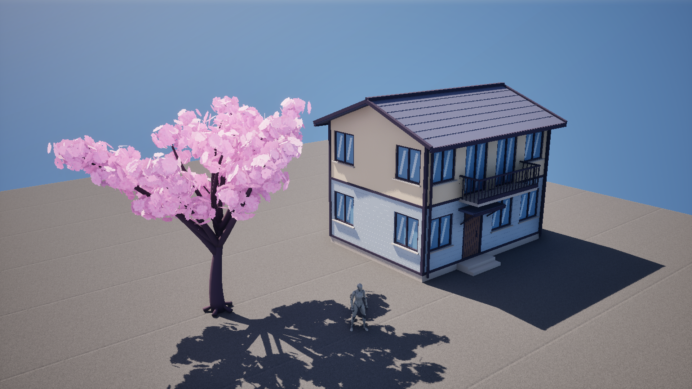

# House and sakura import pilot

Status: passed in Unreal Engine 5.8.4. This pilot imports one assembled House01 and one hero sakura LOD0. No remaining house modules, tree variations, other LODs, café or props were imported.

## Files and destinations

- Workflow and commands: [Tools/Unreal/README.md](../Tools/Unreal/README.md).
- Import script: [import_pilot.py](../Tools/Unreal/import_pilot.py).
- PIE test: [test_import_pilot.py](../Tools/Unreal/test_import_pilot.py).
- Recorded import checks: [ASSET_IMPORT_RESULTS.json](ASSET_IMPORT_RESULTS.json).
- Recorded PIE checks: [ASSET_IMPORT_PIE_RESULTS.json](ASSET_IMPORT_PIE_RESULTS.json).
- Real Unreal capture, 1920 × 1080: [AssetImportPilot.png](Images/AssetImportPilot.png).

Imported static meshes:

```text
/Game/SakuraDays/Environment/Architecture/House01/Revisions/r_65c36027274b/SM_House01
/Game/SakuraDays/Environment/Foliage/Sakura/Hero/Revisions/r_356c82d91a4c/SM_Sakura_Hero
```

Materials are stored in each revision's `Materials` folder; the tree's shared blossom atlas is in its `Textures` folder. These are separate new assets. Source FBXs and Blender files are preserved.

## Import validation

| Check | House01 | Hero sakura |
| --- | --- | --- |
| Unreal bounds, X × Y × Z | 770.50 × 894.00 × 716.50 cm | 917.88 × 961.29 × 767.88 cm |
| Actor scale in test map | 1, 1, 1 | 1, 1, 1 |
| Orientation | Z up, facade facing +X | Z up, FBX front converted to +X |
| Ground pivot | Bottom at Z = 0 | Bottom at Z = 0 |
| Triangles | 9,496 | 11,964 |
| UV channels | 2 | 1 atlas channel |
| Assigned material slots | 8, all assigned | 2, both assigned |
| Render-normal samples | 18,998; zero invalid lengths | 14,400; zero invalid lengths |
| Collision | 3 simple boxes: exterior body and entry steps | 3 imported UCX trunk hulls |

Centimeter bounds match the source manifests within 0.001 cm. Authored normals are retained and MikkTSpace tangents are generated. Normal checks establish finite unit-length render normals, not an exhaustive all-angle winding or shading audit. UV channel counts are verified; the import test does not repeat the source kit's UV packing inspection.

The house uses named matte palette materials and opaque stylized window panels. The tree uses vertex-tinted bark and a two-sided masked foliage material: texture RGB × vertex RGB, texture alpha for opacity, mask threshold 0.4. Vertex alpha is retained for possible future wind and does not drive opacity.

## Play-in-Editor results

Passed map:

```text
/Game/SakuraDays/Maps/Validation/L_AssetImportPilot_20261114_225218_8f831f
```

All 12 recorded checks passed, with no errors in the final import or PIE reports:

- Existing `BP_ThirdPersonCharacter` spawned and was possessed.
- Movement warmup, approach to the house, and departure from it succeeded.
- The house facade blocked the character at the expected exterior position.
- The character walked to the tree; the trunk blocked movement.
- The character left the trunk and walked north and south beneath the canopy without foliage collision.
- The character reached the jump position, jumped approximately 127.3 cm and landed at its starting ground height.
- A real Unreal screenshot was captured from the test camera.

Movement was supplied through the existing pawn's movement-input API during genuine PIE. Keyboard bindings and a packaged build were not retested. The test changes the view target only in the temporary PIE world for the capture; the character and input assets remain unchanged.



## Preservation and repeat runs

An unchanged repeat import passed and reported `reused without writing` for both meshes. Source/recipe fingerprints identify revisions; changed sources or an explicit reimport revision create sibling packages. Existing revisions and references are not overwritten or automatically redirected. Unknown destination assets cause a refusal.

The PIE script refuses a missing/failed/plan-only import report and refuses to replace the current map when any map package has unsaved changes. It does not automatically save unrelated work.

These refusal guards were added after the successful PIE run. Python syntax and the actual setup function were checked with mocked editor calls: dirty-map, failed-report and plan-only cases all stopped before map replacement. The dirty-map API was verified against the installed engine header. The complete PIE sequence was not rerun solely for these guards.

The existing Third Person assets, street map, project descriptor, default map and source art were not modified. Validation uses new uniquely named maps, including the retained earlier test map. Git inspection found no modifications to tracked files. The new `.uasset` and `.umap` paths match the repository's LFS rules. No files were committed or pushed.

## Remaining limitations and warnings

- House collision is an exterior proxy. The interior, roof and balcony are not playable surfaces; test those separately if they become gameplay requirements.
- Only tree LOD0 is imported. LOD switching, wind, foliage instancing, light baking, performance and packaging remain untested.
- The screenshot shows jagged roof/foliage edges and some bright speckling on the house siding. These need an art/rendering review in the intended street lighting before visual approval; this pilot does not establish final style matching.
- Unreal logged deprecation warnings for the working `EditorLevelLibrary` helper calls. These did not fail the test; migrate them to the corresponding editor subsystems during workflow maintenance.
- The editor reported a disabled NVIDIA TSR 16-bit optimization for its detected driver, optional profiler/tablet DLLs absent, and unavailable SDKs for non-Windows platforms. None blocked these Windows editor import/PIE checks. This task did not install drivers or SDKs.

During setup, the material vertex-color connection, Python keepalive API and launcher path escaping were corrected. An initial house movement check ran before input had settled; the final test adds a movement warmup and the full rerun passed. The final reports above are the successful runs.

Review these two imported assets before extending the allowlist to the remaining kit.
