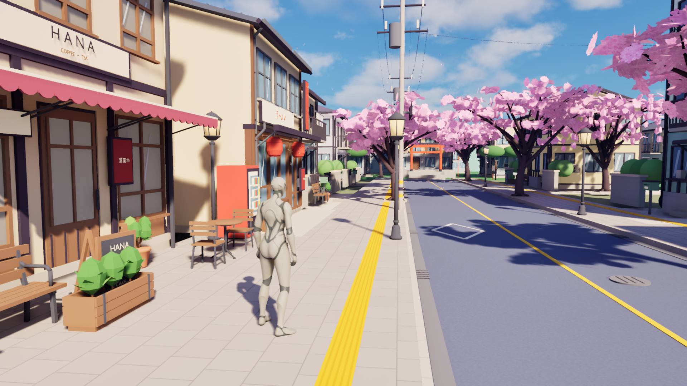

# Prompt 13 — supplied reference update

The missing image set was supplied after the initial [three Dream Loop passes](ANIME_VISUAL_REFINEMENT.md). This follow-up uses the full set for one focused correction of the existing street. Checkpoint `6ec5b17` preserves the prior saved scene (`ff30d2f`) on `codex/anime-reference-followup`.

**Status:** completed on 17 November 2026. One focused reference correction passed **32/32 Play-in-Editor checks**. Eight genuine 1920 × 1080 captures are retained. An independent comparison verified **739 unchanged geometry, collision, camera and spawn records**, an unchanged target hash, and the final saved-map hash.

## How the references apply

Style A and Style B remain the primary rendering and architectural style authorities. The scene remains a warm spring afternoon, as requested in Prompt 13. The added location images inform the existing street's lighting, materials, depth and mood; they do not specify new playable districts for this task.

| Supplied image | Relevant visual guidance |
|---|---|
| Style A | Broad matte surfaces, readable cool shade, modest residential proportions, clear pink/green color groups and dark structural trim. |
| Style B | Warm plaster, legible signs and simple strong accents, with controlled shadows and recognizable everyday Japanese details. |
| 02 — School Campus | Clear blue daylight, soft white clouds, warm cream architecture and pink canopy contrast. The school itself belongs to a future location. |
| 03 — Riverside Path | Layered greenery and blue distance, open daylight and repeated trees leading into depth. River/train geometry is outside this street pass. |
| 04 — Hilltop Overlook | Warm foreground against progressively cooler, quieter distant rooflines and hills. The panorama guides depth rather than a new overlook. |
| 05 — Local Café | Warm wood, framed windows, rose awning, small warm lighting accents and a welcoming entrance. HANA's existing identity and exterior remain. |
| 06 — Residential Alley | Warm plaster and timber, shaded edges, boundary walls and layered depth. Use these relationships within the existing contemporary town. |
| 07 — Train Station | A warm sheltered foreground with readable shade, tactile paving and bright exterior greenery. Existing street signs keep their authored wording. |
| 08 — Evening Sunset | Future sunset palette: orange light, lavender distance and pink blossom silhouettes. It does not replace the requested afternoon lighting. |
| 09 — Night Festival | Future night palette: restrained warm lantern pools against dark blue/purple surroundings. A festival/night conversion is outside this correction. |

These images share stronger warmth and environmental depth than the first captures, but several are more illustrative and detailed than Style A/B. Their glow, texture density and landmark compositions remain subordinate to the approved real-time anime style.

All ten originals are read from the supplied `SakuraDays_Codex_Prompt_Pack/References` folder. Their hashes are recorded in the follow-up evidence manifest; the originals are not edited. The approved `.dream-loop/target.png` stays locked. The previously verified final Prompt 13 captures serve as the genuine before images because their saved-map hash matches the scene at this checkpoint.

## Applied correction and verification

The installed Dream Loop Plus workflow used a fresh implementation worker, followed by root-agent execution and independent visual review. This is one follow-up to the newly supplied images, separate from the original three iterations. Unreal applied the prepared script without authoring errors; the first full validation run completed successfully.

| Change | Actual result in the Unreal captures |
|---|---|
| Five houses: derived plaster and siding materials | Shaded façades are visibly lighter and less dominated by dark blue. Dark structural trim and cool windows remain distinct. |
| HANA glazing: warm color treatment | Blue-gray glazing becomes lighter warm taupe. Existing window frames and reflection strips are preserved. The panes remain opaque; this is not an illuminated café interior. |
| Sky luminance and shadow grade | A modestly clearer blue sky and more readable shade. The change is subtle in the wider street views; sun direction and exposure are unchanged. |

Eleven new material assets are stored in `/Game/SakuraDays/Environment/AnimeRefinement/References`. Original source materials are unchanged. A new owned post-process volume has priority 80. Earlier recipes and evidence remain available. The scene, geometry, actor placements, collisions, Japanese sign geometry, input and camera assets, and project default map are preserved.

For reproducibility, the sky luminance factor is `(0.64, 0.90, 1.30)` and shadow gamma is `(1.10, 1.08, 1.09)`. Exposure min/max remain 1 with bias 1.8; bloom remains 0.04. House plaster uses color multiplier `(1.02, 1.00, 0.96)` and an emissive local-color floor of 0.10; siding uses `(1.04, 1.00, 0.94)` and 0.12. Café glass uses `(1.30, 1.00, 0.72)` and 0.16. These small material contributions make shade readable but are art-directed, not physically calibrated illumination. Material metadata resolves original sources to prevent repeated tint accumulation.

## Genuine before-and-after evidence

The before column is the tested final scene from the initial three passes. Its saved-map hash matched this follow-up's checkpoint. All after images are unedited Unreal `HighResShot` output; no generated image is presented as gameplay.

| View | Before this correction | After this correction |
|---|---|---|
| Fixed reference | [Before](Images/AnimeRefinement/pass3/Reference.png) | [After](Images/AnimeReferenceUpdate/Reference.png) |
| Main street | [Before](Images/AnimeRefinement/pass3/MainStreet.png) | [After](Images/AnimeReferenceUpdate/MainStreet.png) |
| HANA café | [Before](Images/AnimeRefinement/pass3/Hana.png) | [After](Images/AnimeReferenceUpdate/Hana.png) |
| Residential buildings | [Before](Images/AnimeRefinement/pass3/Residential.png) | [After](Images/AnimeReferenceUpdate/Residential.png) |
| Ramen storefront | [Before](Images/AnimeRefinement/pass3/Storefront.png) | [After](Images/AnimeReferenceUpdate/Storefront.png) |
| Third-person gameplay | [Before](Images/AnimeRefinement/pass3/Gameplay.png) | [After](Images/AnimeReferenceUpdate/Gameplay.png) |
| Street sign | [Before](Images/AnimeRefinement/pass3/StreetSign.png) | [After](Images/AnimeReferenceUpdate/StreetSign.png) |
| Noticeboard | [Before](Images/AnimeRefinement/pass3/Noticeboard.png) | [After](Images/AnimeReferenceUpdate/Noticeboard.png) |

The [manifest](Validation/AnimeReferenceUpdate/manifest.json) records image dimensions and hashes, all ten reference hashes, the target hash and saved-map hash. [PIE results](Validation/AnimeReferenceUpdate/PIE.json), [authoring readbacks](Validation/AnimeReferenceUpdate/applied.json) and the [preservation audit](Validation/AnimeReferenceUpdate/preservation.json) are retained beside it.

The original Third Person pawn traversed 17 route waypoints with movement input, including sidewalks, crossings, house frontages and the café approach, then jumped and landed. Both the fixed reference and normal gameplay camera checks passed. Two live Niagara samples verified 144 petals across the existing three zones and downward motion of matching particle IDs. Existing foliage wind graphs were preserved. The editor exited successfully, with no Python, material, shader-compiler or Niagara errors in the checked log categories. No new ambient audio was added.

## Remaining differences and limits

The residential shade is closer to Style A/B, but the match remains incomplete. Windows still use opaque planes and repeated reflection strips; HANA lacks the café reference's visible interior, warm lamps and richer display detail. Architectural modules repeat, shrubs remain simple, blossom cards have angular edges, and the background is thin. The template mannequin remains. This pass does not add a complete cel-shading or outline system, new districts, sunset/festival modes, or gameplay features.

Existing Japanese lettering is preserved and visible in the review captures. HANA's `喫茶 花` and `営業中`, the street's `さくら通り`, and the noticeboard's `掲示板` remain readable at their review cameras. The small ramen-curtain text remains partly occluded by its lantern. This is not a claim that every sign is legible from every gameplay distance.

Hardware ray tracing remains disabled. No new geometry, textures or particles were added; the additional work is material arithmetic and grading. RTX 4050 GPU profiling, masked-foliage overdraw and packaged 1080p frame rate remain unmeasured. PIE success does not certify physical keyboard bindings, every collision approach or release performance.

Reproduction commands are in [the Unreal review workflow](../Tools/Unreal/ANIME_REFINEMENT.md). The changes and evidence are committed locally; this task does not publish to GitHub.
