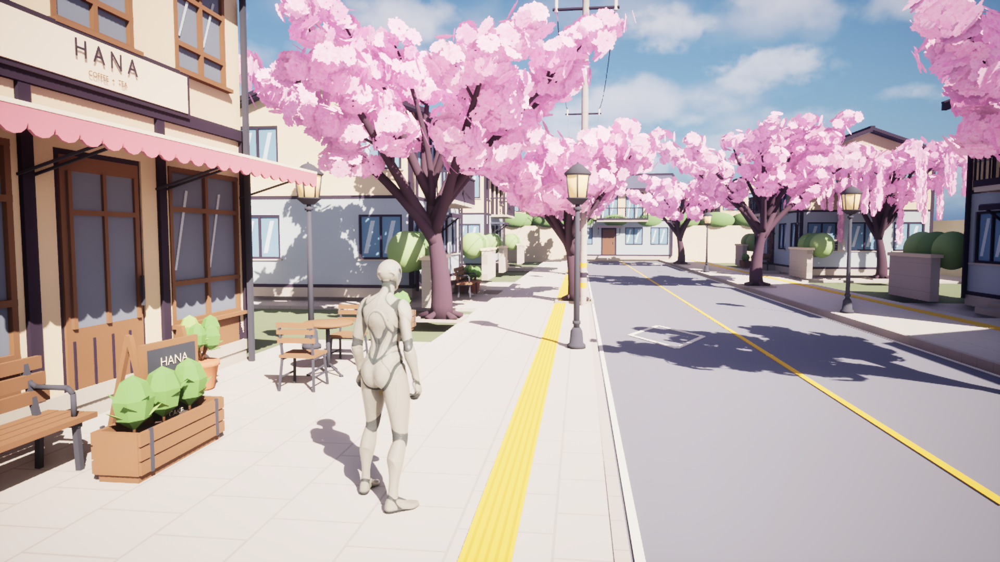
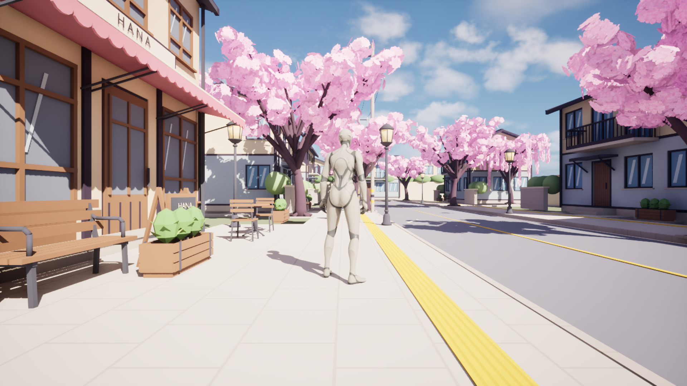

# SakuraDays street environment assembly

The graybox building and tree placeholders in `/Game/SakuraDays/Maps/L_SakuraStreet` have been replaced with the approved imported art kits. Open this map and press Play; the project startup map remains the original Third Person map.

## Scene contents

- HANA café exterior with its original awning, signage, windows, door, terrace furniture, bench, plants and lamp.
- Eight instances of the approved Japanese house: five along the playable street and three forming the background/terminus. These reuse one house design, not eight new models.
- Ten sakura instances using the hero, spread and weeping forms, with trunk collision and nonblocking foliage.
- Additional benches, planters, pots and lamps from the café prop kit.
- Garden walls, simplified shrubs, utility poles and sagging wires; paved sidewalk materials, tactile strips, curbs, a white diamond and a far crossing.
- The existing 60 m site, 6 m road, two 3 m sidewalks, 15 cm curbs, perimeter collision, player spawn and Third Person gameplay behavior.

The saved scene contains 288 actors. The placement recipe manages 267 tagged actors, while the retained base, camera, lighting and street geometry remain separate. The initial replacement removed 42 named graybox building/tree markers. Repeat placement kept the same actor count and did not create duplicate labels.

## Repeatable workflow

See [the workflow instructions](../Tools/Unreal/STREET_SCENE.md) and [PowerShell launcher](../Tools/Unreal/Run-StreetScene.ps1). The implementation is split into:

- [import_street_assets.py](../Tools/Unreal/import_street_assets.py): fingerprinted imports with safe reuse and separate revisions.
- [assemble_street_scene.py](../Tools/Unreal/assemble_street_scene.py): named placements, surface dressing and map saving.
- [verify_street_saved.py](../Tools/Unreal/verify_street_saved.py): read-only verification after reopening the saved map.
- [test_street_scene.py](../Tools/Unreal/test_street_scene.py): genuine PIE traversal and two-camera captures.

New meshes/materials live under `Content/SakuraDays/Environment/Architecture`, `Foliage`, `Props` and `Street`. Scene actors are grouped under `SakuraDays/` in the Outliner and tagged `SakuraDaysStreetAssembly`. Change the recipe to revise generated placements; a repeat run updates those tagged actors. Separately authored actors must remain untagged with distinct names.

Each assembly run retains a byte-for-byte pre-edit map backup under ignored `Saved/StreetAssembly/Backups/`. The original graybox backup is `L_SakuraStreet_143c58869a1e7fbb.umap`; later backups retain subsequent saved versions. These are local recovery copies, not Git commits. Source Blender/FBX files, Third Person templates, character/input assets and project default maps were preserved. No commit or push was performed.

Temporal anti-aliasing was enabled with `r.AntiAliasingMethod=2` to reduce the previously visible edge aliasing. Hardware ray tracing remains disabled. The map's sun direction and intensity were adjusted for its imported materials; no character or input behavior was changed.

## Validation and captures

The import report passed for all 13 placement keys: the existing house and hero were reused, and the café, eight separate props and two other tree forms were imported. The café includes deliberate exterior-shell and furnishing collision proxies; plants block their containers rather than their entire foliage bounds.

The saved-map verifier passed 334 checks with no errors. It verifies expected placements/assets, duplicate labels, removal of the known placeholders, fixed-camera settings, road/sidewalk/boundary transforms and collision, ground heights and tree UCX/foliage settings. The final PIE results are recorded separately in [STREET_PIE_RESULTS.json](STREET_PIE_RESULTS.json).

The final PIE run passed all 23 checks with no errors, including 17 movement waypoints, possession, camera preservation, jump/landing and both captures. It exercises the existing possessed Third Person pawn through movement-input calls: café approach, both sidewalks, house frontages, near/far crossings, road out-and-back and return to spawn. The measured jump rose approximately 127.5 cm and returned to its starting ground height. The test does not teleport the pawn. For the final camera captures only, the PIE pawn is oriented along +X after returning; this does not modify its asset or saved spawn. This checks traversability, not keyboard bindings, NPC pathfinding or packaged performance.

The fixed reference camera remains at `(-480, -180, 210)` cm, pitch `-4°`, yaw `-7°`, roll `0°`, horizontal FOV `75°`, constrained to `16:9`. The gameplay capture uses the existing pawn camera. Both images are real Unreal renders at 1920 × 1080.

Permanent evidence:

- [STREET_IMPORT_RESULTS.json](STREET_IMPORT_RESULTS.json)
- [STREET_ASSEMBLY_RESULTS.json](STREET_ASSEMBLY_RESULTS.json)
- [STREET_SAVED_VALIDATION.json](STREET_SAVED_VALIDATION.json)
- [STREET_PIE_RESULTS.json](STREET_PIE_RESULTS.json)

## Largest remaining visual differences

1. **Character and activity:** the existing mannequin remains. The reference's anime player, NPCs, dialogue, traffic and drifting petals are separate milestone work.
2. **Street depth:** this is a short, straight, bounded street terminating at a house/garden boundary. The target's continuing curve, distant hill and landmark are absent. The fixed camera composition is preserved, but the background cannot reproduce that depth yet.
3. **Architectural variety:** the café is distinct, but houses reuse one design. The references have more varied facades, rooflines, balconies, signs, carports and small service details.
4. **Foliage:** the current crowns are larger, lumpier and brighter than the restrained pink masses in Style A/B. Hanging forms are present, but blossom coverage, branch thickness and distant readability still need an art pass.
5. **Surfaces and lighting:** windows are opaque stylized panels without the target's warm interior depth. Garden shrubs and walls remain simple, surface wear is minimal, and the sky/clouds and shadows retain a standard real-time look. A dedicated anime shading/outline study is still needed; dark modeled trim currently supplies most contours.

Interiors, opening doors, tree wind/LOD chains, full collision coverage from every angle, packaging and frame-rate/overdraw budgets are not validated by this pass. Keep the playable corridors clear when adding future props or effects.

During implementation, Unreal API differences in material construction and collision enum names were corrected. A commandlet run also crashed when a UI-only PIE query was called; headless runs now bypass that query. That run did not save the level. Subsequent assembly and saved-level verification passed.
