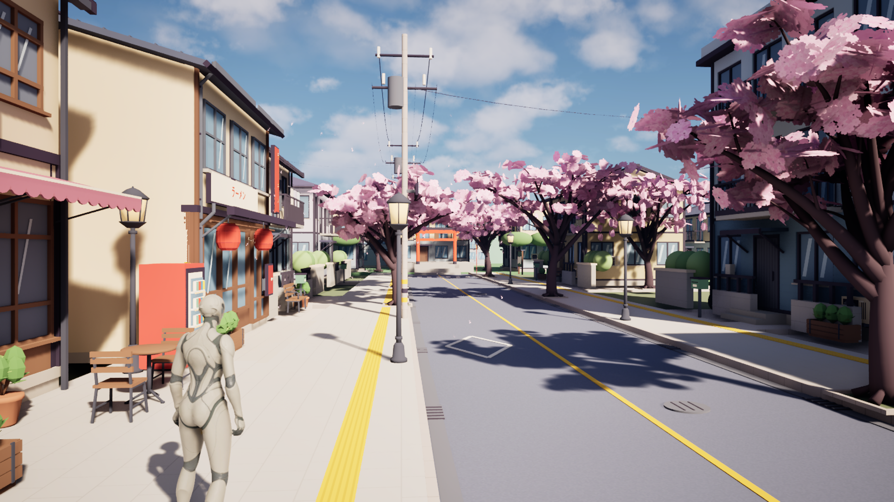
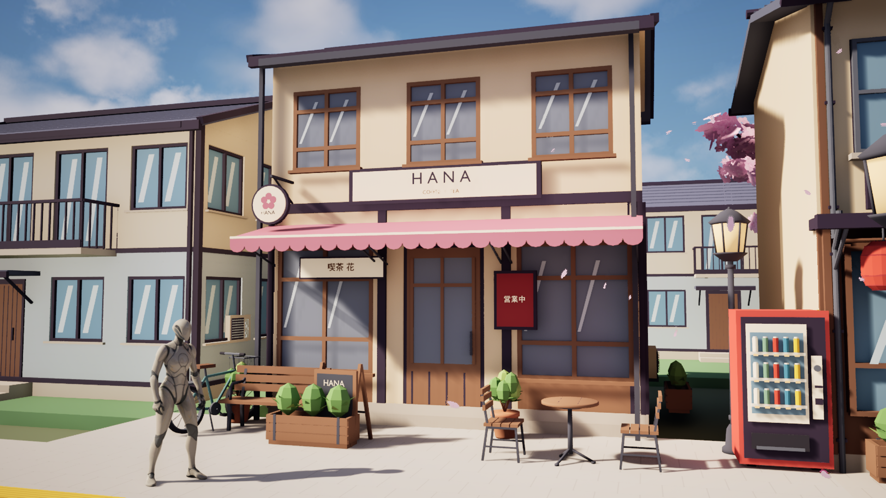
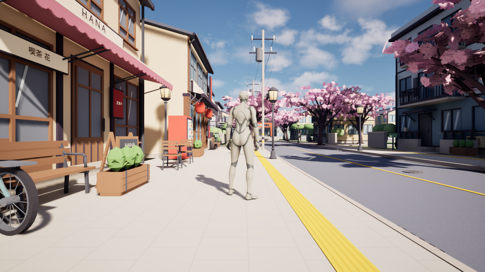

# Japanese town refinement — Prompt 12

The later [Prompt 13 anime refinement](ANIME_VISUAL_REFINEMENT.md) updates lighting and materials while preserving this pass's geometry and gameplay. The images and hashes below document the earlier Prompt 12 checkpoint.

This pass layers Japanese neighborhood details over the existing `/Game/SakuraDays/Maps/L_SakuraStreet`. It keeps the compact playable street, Third Person character and input assets, original HANA café, and approved reference camera. The original Third Person map remains the project default.

**Verification status, 16 November 2026:** the final saved street passed **32/32 Play-in-Editor checks**, with no reported test errors. Eight genuine 1920 × 1080 Unreal captures have been reviewed. Two live Niagara simulation samples verify 144 correctly sized petals above the sidewalks, with matched particles moving downward between samples. Geometry, identity, materials and initial lighting stages each passed 27 checks; the exposure and sign-visibility issues found during review are corrected. This report supersedes the older street assembly report for Prompt 12 work only.

## What changed

- **Architecture:** the existing house kit now has a derived three-storey flat-roof variant and a two-storey hip-roof variant. Three foreground houses use these revisions, while five actor-local façade palettes reduce repetition. Downpipes, meters, AC units, selected shutters, laundry and garden fences provide domestic detail. Original source assets remain available.
- **Businesses and Japanese identity:** a compact ramen exterior joins HANA, with horizontal and vertical lettering, noren curtains and lanterns. HANA retains its original name and gains Japanese café and open-for-business signs. A generic vending machine, two city bicycles, five mailboxes, a public noticeboard and a roadside mirror add neighborhood context.
- **Street:** drain channels, gratings, manhole covers, subtle asphalt and paving patterns, an off-road parking bay and additional utility hardware/service cables refine the existing road and sidewalks. Decorative surface details do not add collision lips across the walking route.
- **Background:** additional reused house silhouettes, muted hills and visual ground extend the scene beyond its compact playable area. The original perimeter collision stays in place while its plain wall surfaces are hidden. A modest torii and shrine threshold provide a distant landmark; the background is scenery rather than an expanded playable district.
- **Sakura:** ten placements use a separate V2 hero, spread or weeping tree revision. Wider, shallower crowns, exposed branch gaps and reduced blossom-card density replace the previous dense tufts. A vertex-weighted material adds subtle horizontal blossom motion while leaving bark still.
- **Animation:** three sparse Niagara zones add gently falling, rotating pink petals. Runtime position, size, count and downward motion were sampled directly from the live simulation.

The café and ramen shop are exteriors. Doors, interiors, NPCs and dialogue are not implemented by this environment pass.

## Japanese lettering

Every sign uses explicit Unicode text converted to mesh geometry from installed Yu Gothic Bold. The source builder validates glyph coverage and records nonzero glyph IDs in its manifest. No AI lettering, random characters or font binary is included. The editable Blender text references the host font; typography edits on another computer require an appropriately licensed Japanese font.

| Text | Meaning | Scene use |
|---|---|---|
| 喫茶 花 | Hana café | Supplemental sign below HANA's awning; the original HANA fascia remains |
| 営業中 | Open for business | Café entrance sign and ramen shop signage |
| ラーメン | Ramen | Ramen fascia, projecting vertical sign and entrance curtain |
| さくら通り | Sakura Street | Street-name sign on a utility pole |
| 掲示板 | Noticeboard | Neighborhood noticeboard heading |

The vertical ラーメン sign rotates the prolonged-vowel mark for vertical writing. The kit also contains a correctly worded 止まれ stop sign, but it is not placed on this uninterrupted street. 商店街 and 駅前通り are not added because the current layout does not establish a shopping district or station approach. Notice papers use ruled graphics rather than invented small print.

Glyph coverage, import success and final rendered lettering are verified. The final HANA, storefront, street-sign and noticeboard views show correct Japanese glyphs without missing-character boxes. The main horizontal and vertical ramen signs are unobstructed; two trees were repositioned to clear them, and the street-name sign was brought forward onto a bracket to clear its pole. A lantern still partly obscures the last character on the smaller secondary ramen entrance curtain from the storefront review angle. Primary signs remain readable, but lettering naturally becomes too small at the far end of the street.

## Source and asset organization

| Location | Contents |
|---|---|
| `SourceArt/Environment/JapaneseTown01/` | Editable Blender town kit, 25 modular FBX exports, palette/geometry manifest, four genuine Blender previews |
| `SourceArt/Architecture/HouseTownVariants/` | Two derived house silhouettes, editable Blender source, FBXs and dimensions manifest |
| `SourceArt/Foliage/SakuraTreeKitV2/` | Three refined tree forms, three LODs each, shared blossom atlas, editable source and source QA/previews |
| `Content/SakuraDays/Environment/JapaneseTown/Prompt12/` | Fingerprinted town imports, derived houses and palette materials |
| `Content/SakuraDays/Environment/Foliage/Sakura/Prompt12/` | Fingerprinted V2 tree meshes, LODs and foliage material |
| `Content/SakuraDays/Effects/Petals/Prompt12/` | Saved Niagara petal system and masked petal material |
| `Tools/Unreal/` | Import, placement, effects authoring and live PIE validation scripts |
| `Docs/Images/Town_*.png`, `Docs/Validation/TownRefinement/` | Eight permanent Unreal captures, sanitized validation reports and a SHA-256 evidence manifest |
| `Saved/TownRefinement/` | Local stage reports, pre-edit map backups, logs and test captures; ignored by Git |

See the [town source guide](../SourceArt/Environment/JapaneseTown01/README.md) and [V2 tree guide](../SourceArt/Foliage/SakuraTreeKitV2/README.md) for geometry, pivots, material slots and original Blender previews. Blender units are meters, Z is up and façades face -Y. Unreal imports convert to centimeters and force the façade to +X; X/Y bounds therefore swap.

## Repeatable workflow and preservation

The pre-edit Git checkpoint is `2dfb44d` on `codex/japanese-town-refinement`. Stage scripts also copy the current map into ignored `Saved/TownRefinement/Backups/` before editing it. Local map backups are not a substitute for a committed checkpoint.

Run the scripts in the existing project's Unreal Editor Python environment. Save any intentional editor work normally before starting: the scene helper refuses to proceed if it finds dirty maps. Do not run two authoring/editor instances against the map concurrently.

| Order | Script | Responsibility |
|---|---|---|
| 1 | `import_town_assets.py` | Import and validate the selected 14 town-kit exports into source-fingerprinted folders |
| 2 | `run_town_identity.py` | Apply the geometry and Japanese-identity placement stages |
| 3 | `run_town_materials.py` | Import both house variants and three tree forms, then apply actor-local material variation |
| 4 | `refine_japanese_town.py` | Run one named stage with `SAKURA_TOWN_STAGE=geometry`, `identity`, `materials` or `lighting` |
| 5 | `create_sakura_petals.py` | Author, compile-check and place the sparse Niagara petal system |
| 6 | `test_town_stage.py` | Traverse the saved map in real PIE and capture the review views |

The authoring helpers use Unreal asset APIs. New imports have source fingerprint revisions; they do not replace the original house, café or tree assets. Prompt 12 placements have `JP_` labels, the `SakuraDaysTownRefinement` tag and Outliner folders beneath `SakuraDays/Prompt12`. Repeat placement updates these owned actors rather than spawning duplicates, and refuses a matching label without the ownership tag. Existing road, sidewalks, spawn and approved reference-camera transforms are compared before and after every placement stage.

Repeatability is **recipe ownership**, not a merge of manual edits: rerunning a stage resets its named placements and material assignments to the recipe. Preserve intentional manual edits in source parameters or a new revision first. Existing fingerprinted imports are reused, and their task-owned material/collision settings may be refreshed. Blender builders likewise regenerate their own outputs; preserve hand-edited sources before rerunning them.

Do **not** rerun the older `assemble_street_scene.py` over the finished Prompt 12 map: its base recipe would restore earlier placements/material assignments. Start from the saved refined map and use these additive stage scripts.

Standard authoring enables the built-in Python Editor Script Plugin and Editor Scripting Utilities. Niagara authoring additionally enables the installed `CascadeToNiagaraConverter` and `NiagaraToolsets` for that editor session. The spawn-offset module is copied into the project's effects folder so the saved system has no runtime dependency on converter-plugin content. The final verification editor opened the map and ran PIE without enabling those authoring-only plugins. No C++ conversion or permanent plugin-configuration edit was made.

Set `SAKURA_TOWN_TEST_STAGE` to label a PIE evidence folder. The `final` label additionally samples actual Niagara simulation data twice, at least one game-second apart. `SAKURA_TOWN_TEST_EXIT=1` closes the test editor normally after recording its evidence. Full rendering/PIE tests require the normal Unreal Editor, not a NullRHI commandlet.

`run_town_lighting.py` and `run_town_effects.py` provide stage entry points. `run_town_final.py` reapplies owned geometry/identity placements and runs the final PIE suite; use `test_town_stage.py` directly to validate without reapplying placements.

## Verified imports and gameplay

The town importer passed all 14 selected meshes. It compared centimeter bounds and orientation, triangle counts, material-slot order and UV channel count against the Blender manifest, and inspected render normals for finite unit length. The derived UrbanFlat and HipRoof house imports passed scale/UV checks and each has three simple collision shapes. They have 10,520 and 8,048 triangles respectively, with two UV channels.

All three tree imports passed bounds, materials, render-normal, LOD and trunk-collision validation. Each has three trunk hulls, one intentionally overlapping atlas UV channel and two material slots. The render LOD screen sizes were read back as approximately `1.0, 0.38, 0.16`.

| Tree | Imported LOD0 | Imported LOD1 | Imported LOD2 | LOD0 reduction from original |
|---|---:|---:|---:|---:|
| Hero | 8,250 | 3,792 | 1,200 | 31.0% |
| Spread | 6,646 | 3,056 | 996 | 30.6% |
| Weeping | 11,928 | 5,472 | 1,546 | 39.7% |

These corrected imported render counts exactly match the Blender source manifest. The exporter includes collision only in LOD0 because Unreal's `import_lod` otherwise treats UCX objects as render geometry. The importer now enforces exact source triangle counts for every LOD, and all three revised trees passed. Blossom-card counts fall by roughly 60–68%. No measured frame-rate improvement is inferred from triangle reduction alone.

| Stage | Current evidence | Result |
|---|---|---|
| Geometry | `Saved/TownRefinement/PIE_geometry/validation.json` | Complete; 27/27 checks passed |
| Japanese identity | `Saved/TownRefinement/PIE_identity/validation.json` | Complete; 27/27 checks passed |
| Materials and revised meshes | `Saved/TownRefinement/PIE_materials/validation.json` | Complete; 27/27 checks passed |
| Initial lighting | `Saved/TownRefinement/PIE_lighting/validation.json` | Complete; 27/27 checks passed; initial underexposure corrected before the final run |
| Petal compile | `Saved/TownRefinement/petals.json` | Passed; up to date, no compile/stack errors or warnings |
| Live petal simulation | [Final PIE report](Validation/TownRefinement/PIE_final.json) | Two samples passed: 48 petals in each of three zones, 5 × 7 cm sprites, downward motion and above-ground positions |
| Final saved scene and screenshots | [Evidence manifest](Validation/TownRefinement/manifest.json) | Complete; 32/32 checks passed, eight reviewed 1920 × 1080 captures |

The final route exercises 17 waypoints with the possessed original Third Person pawn through movement-input calls, without teleporting: café approach, both sidewalks, house frontages, near/far crossings, road out-and-back and return to spawn. Jump/landing and the normal gameplay camera are also checked; the jump rose approximately 127 cm. These tests establish traversability and existing pawn behavior, not physical keyboard bindings, every possible collision approach, NPC navigation or packaged-game performance. The final editor exited normally with process code 0.

The approved reference camera remains at `(-480, -180, 210)` cm, pitch `-4°`, yaw `-7°`, roll `0°`, horizontal FOV `75°` and aspect ratio `16:9`. Separate named review cameras show the café, residential buildings, ramen frontage and main street. The test uses actual PIE rendering for all 1920 × 1080 captures.

## Lighting, animation and performance scope

Hardware ray tracing remains disabled. Virtual shadow maps were disabled after a non-Nanite marking queue overflow was observed in an earlier live test; the lighting recipe uses three cascaded shadow maps with an 11,000 cm distance. Temporal anti-aliasing remains enabled. Tiny service cables and distant decorative objects omit shadows where specified by the placement recipe.

The saved lighting correction uses warm daylight at a 36° sun elevation, sun intensity 5.5, skylight intensity 1.2, fixed exposure with bias 2.0, bloom intensity 0.08 and no motion blur. Final captures show readable daylight façades and cool shadows. Surface materials favor high roughness, low specular and restrained color variation; windows and the roadside mirror use opaque authored reflection shapes. A completed cel-shading or screen-outline system remains future work.

The foliage material uses vertex alpha solely as wind weight; texture alpha controls masking. Maximum horizontal displacement is 2.3 cm and bark weights are zero. Shader setup and final canopy placement were reviewed. Close-up card visibility, temporal shimmer and LOD transitions still need a dedicated moving-camera polish pass.

The saved Niagara system, `NS_SakuraPetals_v2`, runs in three local-space CPU emitter instances, each spawning four 5 × 7 cm petal sprites per second for a 12-second lifetime: 144 steady particles in total. Petals have modest horizontal drift, downward velocity of 24–32 cm/s and rotation, with no collision or shadow casting. A spawn-offset module runs after particle initialization so its positions are retained. Compile diagnostics report all scripts up to date; stack diagnostics report zero errors, warnings or informational issues. Earlier unused asset revisions are preserved rather than deleted.

Two immediate Niagara simulation-cache samples, separated by at least one game-second and without manually advancing simulation, each recorded 48 particles per zone. All sampled petals were above the 20 cm clearance threshold, with actual 5 × 7 cm sprite sizes. Matched particle IDs moved downward between frames. The second sample's world-space heights ranged from approximately 99 to 553 cm across the three zones. Simulation time is recorded separately from game time because background editor throttling can affect advancement. No ambient audio is added because no suitable licensed audio was supplied.

The authoring-only `petals.json` deliberately retains `runtime_activity_verified: false`; the subsequent successful live verification is recorded in [PIE_final.json](Validation/TownRefinement/PIE_final.json).

The target machine has an RTX 4050 Laptop GPU with 6 GB VRAM. The materials-stage editor capture callback recorded a 16.68 ms median and 18.53 ms 95th-percentile Slate interval. This is an editor timing observation, not a GPU benchmark or a guaranteed 60 fps result. Masked overdraw, material sections, draw calls, shadow costs and packaged 1080p performance still need profiling.

## Final captures and remaining art work

The following images are genuine captures of the saved map rendered in Unreal PIE. The [evidence manifest](Validation/TownRefinement/manifest.json) records their dimensions and SHA-256 hashes, the saved map hash, and links to the permanent validation reports. `publish_town_evidence.py` copies these results locally; it does not upload them.

| View | Capture |
|---|---|
| Main Sakura Street | [Main street](Images/Town_MainStreet.png) |
| HANA café and Japanese lettering | [Café](Images/Town_Hana.png) |
| Varied Japanese residential buildings | [Residential view](Images/Town_Residential.png) |
| Ramen storefront and street details | [Storefront](Images/Town_Storefront.png) |
| Normal third-person gameplay camera | [Gameplay](Images/Town_Gameplay.png) |
| Preserved fixed reference camera | [Reference view](Images/Town_Reference.png) |
| Unobstructed street-name lettering | [さくら通り sign](Images/Town_StreetSign.png) |
| Neighborhood noticeboard | [掲示板](Images/Town_Noticeboard.png) |

Compared with Style A/B, the new signs, compact shop, utility details and varied rooflines improve Japanese town identity. The remaining large visual differences are the template mannequin, repeated underlying house/window modules, simplified shrubs and architectural surfaces, conspicuous foliage cards at close range, standard real-time clouds/shadows, and a short bounded street rather than a larger continuing town. Window interiors remain opaque. The torii is only a small scenic threshold, not a modeled shrine complex. NPC conversation, traffic, interactive shops, audio, final stylized shading and release packaging remain future work.
