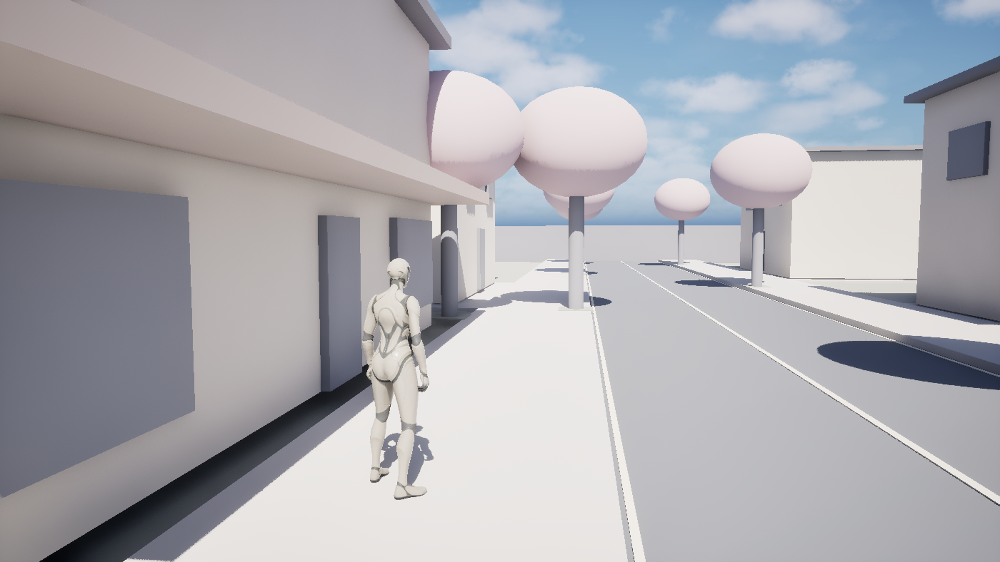

# SakuraDays 🌸

**Status: early development — work in progress.** Much of the game remains to be built; the current project is a playable street graybox and an art prototype, not a finished game.

SakuraDays is a Blueprint-first Unreal Engine project exploring a quiet, anime-inspired Japanese neighborhood in spring. The first milestone is a walkable sakura-lined street with a café, one NPC, a short conversation and falling petals.


*Actual Unreal Editor playtest capture; the scene is a graybox, not final art.*

## Current progress

- Third Person template controls and a separate playable street graybox with road, sidewalks, café and house plots, and tree markers.
- Navigation and collision smoke tests, a fixed reference camera, and documented art direction.
- One modular Japanese residential house authored in Blender, ready for visual review; it has not yet been placed in the street.

The café interior, NPC and dialogue, final buildings and foliage, falling petals, audio, gameplay polish and packaging are still ahead. See the [roadmap](Docs/ROADMAP.md) and [technical plan](Docs/TECHNICAL_PLAN.md).

## Getting started

1. Install Unreal Engine 5.8 (the project was developed with 5.8.4), Git, and Git LFS. Blender 5.2 is useful for editing the source art.
2. Clone the repository and retrieve its large assets:

   ```sh
   git lfs install
   git clone https://github.com/DhruvGadia/SakuraDays.git
   cd SakuraDays
   git lfs pull
   ```

3. Open `sakuradays.uproject` in Unreal Editor. The original Third Person map is the default. Open `/Game/SakuraDays/Maps/L_SakuraStreet` in the Content Browser and press Play to explore the graybox.

The project targets desktop scalability, with hardware ray tracing initially disabled. No packaged release is available yet.

## Project structure

| Path | Contents |
| --- | --- |
| `Content/SakuraDays/` | Street graybox map and its prototype materials |
| `Content/ThirdPerson/`, `Content/Characters/`, `Content/Input/` | Existing template and shared gameplay assets |
| `SourceArt/Architecture/House01/` | Editable Blender house, modular FBX exports, previews and validation notes |
| `Docs/` | Roadmap, technical plan, art direction and graybox test report |
| `References/` | Prepared visual target for future art review |

Unreal `.uasset` and `.umap` files and Blender `.blend` files use Git LFS. Generated caches, local editor state and Dream Loop output are excluded from version control. The house [asset guide](SourceArt/Architecture/House01/README.md) describes dimensions, import settings and remaining work.

## Development notes

The existing Third Person content and controls are preserved while milestone work is developed in a separate map. See [AGENTS.md](AGENTS.md) for project conventions and [art direction](Docs/ART_DIRECTION.md) for the intended visual identity. No license is currently specified; contact the project owner before reusing project content.
