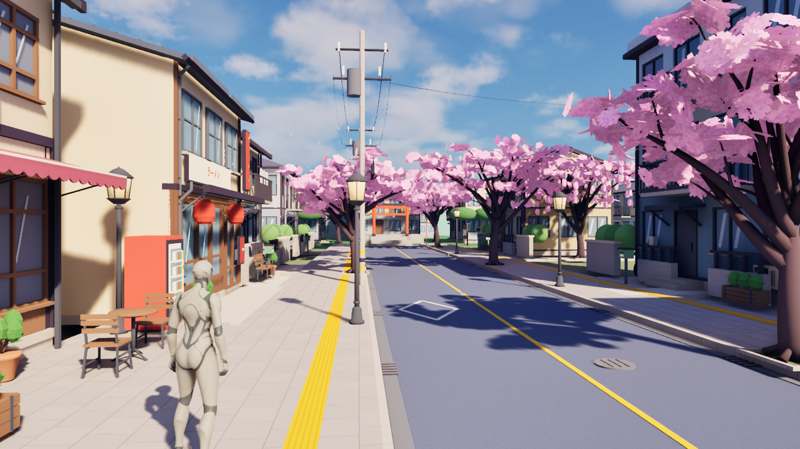

# SakuraDays 🌸

**Status: early development — work in progress.** Much of the game remains to be built. The current project contains a playable art-pass street, but it is not a finished game.

SakuraDays is a Blueprint-first Unreal Engine project exploring a quiet, anime-inspired Japanese neighborhood in spring. The first milestone is a walkable sakura-lined street with a café, one NPC, a short conversation and falling petals.


*Actual 1920×1080 Unreal Engine Play-in-Editor capture after three controlled anime lighting/material refinement passes.*

## Current progress

- Preserved Third Person template controls in a separate 60 m playable street map.
- An original HANA café exterior, Japanese house kit, three sakura forms and a neighborhood prop set authored in Blender and imported through repeatable Unreal Python workflows.
- A dressed street with roads, sidewalks, buildings, sakura trees, garden walls, lamps, utility poles and wires.
- HANA and ramen storefronts with authored Japanese lettering, vending machines, bicycles, mailboxes, drainage, utility equipment and a small scenic torii.
- Flat-roof and hip-roof house variants, lighter sakura canopies with three LODs, subtle blossom wind and a sparse Niagara petal effect.
- Fixed-reference and gameplay-camera captures, documented art direction, import validation and a full Play-in-Editor traversal test.
- Three Dream Loop refinement passes with warmer daylight, controlled pink/green colors, clearer paving and 32 passing PIE checks per pass. Original before-and-after Unreal captures are retained.

The anime player character, NPC and dialogue, café interior, further architectural and shading polish, audio, performance profiling and packaging are still ahead. See the [roadmap](Docs/ROADMAP.md), [technical plan](Docs/TECHNICAL_PLAN.md), [town refinement report](Docs/TOWN_REFINEMENT.md) and [latest anime visual comparison](Docs/ANIME_VISUAL_REFINEMENT.md).

## Getting started

1. Install Unreal Engine 5.8 (the project was developed with 5.8.4), Git, and Git LFS. Blender 5.2 is useful for editing the source art.
2. Clone the repository and retrieve its large assets:

   ```sh
   git lfs install
   git clone https://github.com/DhruvGadia/SakuraDays.git
   cd SakuraDays
   git lfs pull
   ```

3. Open `sakuradays.uproject` in Unreal Editor. The original Third Person map remains the default. Open `/Game/SakuraDays/Maps/L_SakuraStreet` in the Content Browser and press Play to explore the street.

The project targets desktop scalability, with hardware ray tracing initially disabled. No packaged release is available yet.

## Project structure

| Path | Contents |
| --- | --- |
| `Content/SakuraDays/` | Playable street, imported environment art, materials and validation maps |
| `Content/ThirdPerson/`, `Content/Characters/`, `Content/Input/` | Existing template and shared gameplay assets |
| `SourceArt/Architecture/House01/` | Editable Blender house, modular FBX exports, previews and validation notes |
| `SourceArt/Architecture/Cafe01/` | Editable café/prop source, Unreal-ready FBX exports and previews |
| `SourceArt/Foliage/SakuraTreeKit/` | Hero, spread and weeping sakura sources, LOD exports, atlas and previews |
| `SourceArt/Environment/JapaneseTown01/` | Ramen exterior, Japanese signs, neighborhood details and editable Blender source |
| `SourceArt/Architecture/HouseTownVariants/` | Derived flat-roof and hip-roof house revisions |
| `SourceArt/Foliage/SakuraTreeKitV2/` | Refined canopy sources, optimized render LODs, atlas and previews |
| `Tools/Unreal/` | Repeatable asset import, street assembly and PIE validation scripts |
| `Docs/` | Roadmap, technical plan, art direction, screenshots and validation evidence |
| `References/` | Prepared visual target for future art review |

Unreal `.uasset` and `.umap` files and Blender `.blend` files use Git LFS. Generated caches, logs, local editor state, local backups and Dream Loop output are excluded from version control. Asset and workflow details are in the [house guide](SourceArt/Architecture/House01/README.md), [café guide](SourceArt/Architecture/Cafe01/README.md), [tree guide](SourceArt/Foliage/SakuraTreeKit/README.md) and [street workflow](Tools/Unreal/STREET_SCENE.md).

## Development notes

The existing Third Person content and controls are preserved while milestone work is developed in a separate map. See [AGENTS.md](AGENTS.md) for project conventions and [art direction](Docs/ART_DIRECTION.md) for the intended visual identity. No license is currently specified; contact the project owner before reusing project content.
