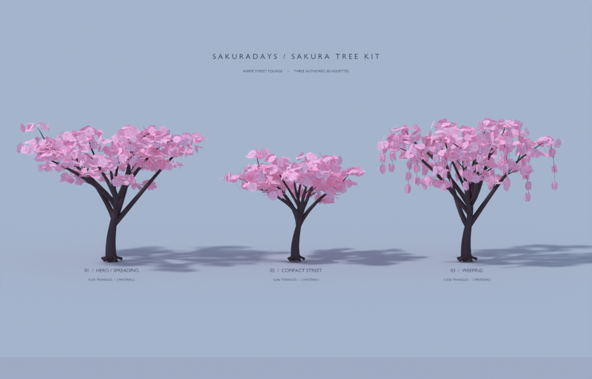
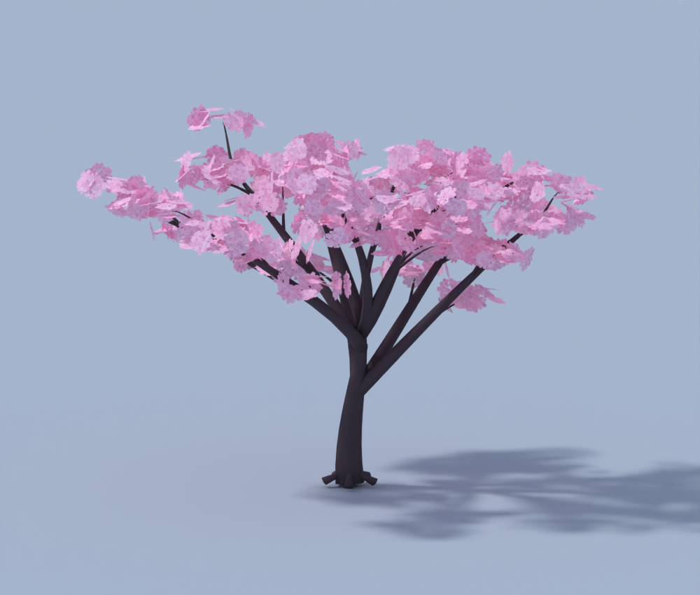

# Sakura tree kit — V2 canopy refinement

This separate revision keeps the original `SakuraTreeKit` intact. It opens the crowns into wider, shallower, asymmetric blossom shelves, exposes more branch structure, reduces dense spherical tufts, and adds larger gaps between hanging sprays. The three deterministic seeds produce spreading hero, compact street, and weeping silhouettes.

`SakuraTreeKit.blend` is the editable source. `build_tree_kit.py` regenerates this revision's named source, FBX files, atlas and previews; copy hand edits before rebuilding. Each of the three LOD0 FBXs in `Exports` contains one tree render mesh and three named convex trunk collision proxies. The six LOD1/LOD2 FBXs contain only their render mesh: Unreal's `import_lod` otherwise includes UCX geometry in the visible lower LOD. Import LOD1 and LOD2 into the corresponding LOD0 static mesh; the LOD0 collision is shared. The editable Blender source retains three collision proxies alongside every source LOD mesh for inspection, but higher-LOD export selection excludes them.

| Tree | Original LOD0 triangles | V2 LOD0 | V2 LOD1 | V2 LOD2 | LOD0 reduction | Blossom cards, original → V2 |
|---|---:|---:|---:|---:|---:|---:|
| Hero | 11,964 | 8,250 | 3,792 | 1,200 | 31.0% | 2,268 → 897 |
| Spread | 9,572 | 6,646 | 3,056 | 996 | 30.6% | 1,800 → 715 |
| Weeping | 19,792 | 11,928 | 5,472 | 1,546 | 39.7% | 4,306 → 1,366 |

These are measured source geometry counts, excluding collision hulls. Card count falls by 60.4%, 60.3% and 68.3%, respectively. Fewer cards and triangles do not establish a measured frame-rate improvement; masked overdraw, shadow rendering and scene density still need in-engine profiling.

| Tree | LOD0 dimensions, Blender X × Y × Z, metres |
|---|---|
| Hero | 10.307 × 9.623 × 7.274 |
| Spread | 7.967 × 7.048 × 5.894 |
| Weeping | 10.108 × 8.389 × 7.879 |

The base pivot is `(0, 0, 0)`, transforms are unit scale, Blender Z is up and -Y is the authored front. FBX export uses metres, `FBX_SCALE_UNITS`, forward -Y, up Z and sRGB vertex colors. The existing Unreal importer converts to centimetres and forces front X. Crown widths are larger than the original kit, especially Spread and Weeping; placement must check roofs, utility wires, signs and camera clearance.

Two material slots are retained in order: `M_Sakura_Bark`, then `M_Sakura_Blossom`. `Textures/T_Sakura_Blossom_Atlas.png` is the shared original procedural 1024 × 1024 atlas. UV0 uses intentionally overlapping atlas islands for blossoms and cylindrical bark UVs. There is no dedicated lightmap UV1; the intended scene uses dynamic lighting. Vertex RGB is a linear material tint. Vertex alpha is a wind weight, with zero on bark; it must not be connected to opacity. Use the atlas alpha for a two-sided masked foliage material (the source preview uses cutoff 0.4). Suggested LOD screen sizes are `1.0, 0.38, 0.16`; review transitions in the actual gameplay camera.

`preview_validate.py` loads the existing blend without changing or resaving it. It checks all nine meshes and renders CPU Cycles previews at 16 samples using eight threads. The 54 source checks passed: origin and scale, finite and nondegenerate triangles, finite UV0 values within the atlas range, two material slots, vertex color attributes and three collision proxies per mesh. Detailed results are in `Previews/source_validation.json`.





These are genuine Blender previews, not Unreal captures. Visual inspection confirms clearer branch gaps and lighter crowns than the former dense tuft arrangement. Close views still reveal angular cards, repeated spray shapes and isolated hanging blossom patches; the trees are stylized rather than botanically exact. The large main boughs and root flares remain simplified. Final wind amplitude, shadow density, card shimmer and LOD transitions must be judged in Unreal at 1080p.

Reproduce source QA and previews from the project root:

```powershell
& 'C:\Program Files\Blender Foundation\Blender 5.2\blender.exe' --background --python SourceArt/Foliage/SakuraTreeKitV2/preview_validate.py
```
